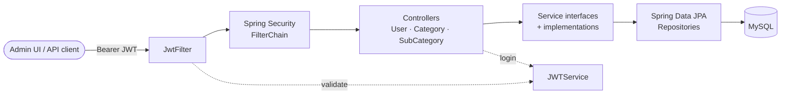
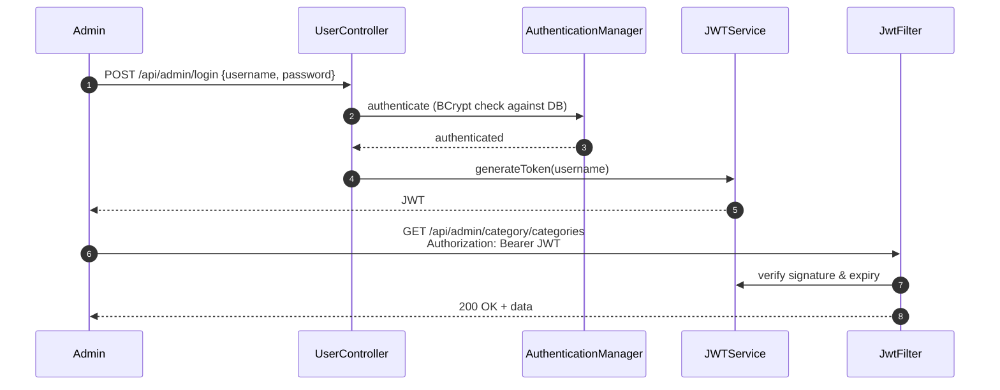

# E-Commerce Admin Portal – REST API

The backend for an e-commerce **admin portal**, built with **Spring Boot 3**, **Spring Security 6 (JWT)** and **Spring Data JPA / MySQL**. Admins register and log in to get a JWT. They then manage the store's **product catalogue**: categories and their sub-categories, with priorities to control display order.

The project uses a layered architecture (controller → service interface → service implementation → repository), stateless token-based security. It also follows a branch-based release flow (`dev` → `preprod` → `prod`).


---

## Features

### Authentication and security
- Admin **registration** with BCrypt (strength 12) password hashing
- **Login** that issues an HMAC-SHA256-signed **JWT** (JJWT 0.12)
- A custom `OncePerRequestFilter` (`JwtFilter`) that validates the `Bearer` token on every request
- **Stateless** sessions. Every endpoint except login and register requires a valid token.
- Database-backed `UserDetailsService` with a `DaoAuthenticationProvider`

### Catalogue management
- **Categories**: create and list
- **Sub-categories**: create and list. Each one is linked to a parent category, which is validated on create.
- Category names are **unique** (DB constraint). A **priority** field controls ordering in the storefront.
- The sub-category stores the parent's id and name, so listings need no join
- Get-by-id, update and cascade delete are on the `dev` branch

---

## Architecture



### Authentication flow



---

## Tech stack

| Layer          | Technology                                       |
|----------------|--------------------------------------------------|
| Language       | Java 21                                          |
| Framework      | Spring Boot 3.3.2 (Web, Security, Data JPA)      |
| Security       | Spring Security 6, JJWT 0.12.5, BCrypt           |
| Persistence    | MySQL 8, Hibernate, Spring Data JPA |
| Build          | Maven (wrapper included)                         |
| Testing        | JUnit 5, Spring Boot Test, Spring Security Test  |

---

## Project structure

```
src/main/java/com/ecomm/admin
├── EcommAdminApplication.java
├── config
│   ├── SecurityConfig.java            # filter chain, auth provider, auth manager
│   └── JwtFilter.java                 # validates Bearer tokens
├── controller
│   ├── UserController.java            # register / login
│   ├── CategoryController.java        # categories
│   └── SubCategoryController.java     # sub-categories
├── model
│   ├── Users.java · UserPrincipal.java
│   ├── Category.java · SubCategory.java · SubCategoryDTO.java
├── repo
│   ├── UserRepo.java
│   ├── CategoryRepo.java
│   └── SubCategoryRepo.java
└── service
    ├── JWTService.java · MyUserDetailsService.java · UserService.java
    ├── CategoryService.java · SubCategoryService.java
    └── impl
        ├── CategoryServiceImpl.java
        └── SubCategoryServiceImpl.java
```

---

## API reference

All endpoints except **register** and **login** need the header `Authorization: Bearer <token>`.

### Auth – `/api/admin`

| Method | Endpoint     | Description                 |
|--------|--------------|-----------------------------|
| POST   | `/register`  | Register an admin user      |
| POST   | `/login`     | Log in, returns a JWT       |

### Categories – `/api/admin/category`

| Method | Endpoint        | Description          |
|--------|-----------------|----------------------|
| GET    | `/categories`   | List all categories  |
| POST   | `/create`       | Create a category    |

### Sub-categories – `/api/admin/subcategory`

| Method | Endpoint          | Description                              |
|--------|-------------------|------------------------------------------|
| GET    | `/subcategories`  | List all sub-categories                  |
| GET    | `/categories`     | List parent categories (for dropdowns)   |
| POST   | `/create`         | Create a sub-category under a category   |

### Example session

```bash
BASE=http://localhost:8080/api/admin

# 1. Register and log in
curl -X POST $BASE/register -H "Content-Type: application/json" \
     -d '{"username":"admin","password":"S3cure!pass"}'

TOKEN=$(curl -s -X POST $BASE/login -H "Content-Type: application/json" \
     -d '{"username":"admin","password":"S3cure!pass"}')

# 2. Create a category
curl -X POST $BASE/category/create \
     -H "Authorization: Bearer $TOKEN" -H "Content-Type: application/json" \
     -d '{"categoryName":"Electronics","categoryPriority":1}'

# 3. Create a sub-category under it
curl -X POST $BASE/subcategory/create \
     -H "Authorization: Bearer $TOKEN" -H "Content-Type: application/json" \
     -d '{"subCategoryName":"Laptops","subCategoryPriority":1,"categoryId":1}'

# 4. List sub-categories
curl $BASE/subcategory/subcategories -H "Authorization: Bearer $TOKEN"
```

---

## Getting started

### Prerequisites
- JDK 21
- MySQL 8

### 1. Create the database

```sql
CREATE DATABASE ecomm;
```

Hibernate creates the tables on startup (`ddl-auto=update`).

### 2. Configure credentials

The application reads its database settings from environment variables, so no credentials are stored in the code:

| Variable      | Required | Default                                                            |
|---------------|----------|--------------------------------------------------------------------|
| `DB_PASSWORD` | Yes      | none                                                               |
| `DB_USERNAME` | No       | `root`                                                             |
| `DB_URL`      | No       | `jdbc:mysql://localhost:3306/ecomm?useSSL=false&serverTimezone=UTC` |

```bash
# Linux / macOS
export DB_PASSWORD=your_password
# Windows (PowerShell)
$env:DB_PASSWORD="your_password"
```

### 3. Run

```bash
./mvnw spring-boot:run        # Windows: mvnw.cmd spring-boot:run
```

The API is available at **http://localhost:8080**.

---

## Branches and feature status

| Branch    | Purpose                    | Catalogue features                                                    |
|-----------|----------------------------|-----------------------------------------------------------------------|
| `dev`     | Active development         | Full Category + Sub-category CRUD, cascade delete                      |
| `main`    | Integration branch         | Category + Sub-category create & list                                 |
| `preprod` | Release candidate / staging | Category create & list                                                |
| `prod`    | Production-ready code      | Category create & list                                                |

Features move `dev` → `main` → `preprod` → `prod` as they are completed and tested. **`dev` has the most complete feature set.** This README describes the `main` branch.

---

## Roadmap

- Role-based access (`ADMIN`, `MANAGER`) with `@PreAuthorize`, and roles stored in JWT claims
- Global exception handling (`@ControllerAdvice`) with proper HTTP status codes and a consistent error body
- Request/response DTOs with Bean Validation (`@Valid`, `@NotBlank`)
- Pagination and sorting on list endpoints
- Externalised JWT signing key (secret manager) and refresh tokens
- Product management (products, images, pricing, stock) on top of the category tree
- OpenAPI / Swagger UI documentation
- Integration tests with MockMvc and Testcontainers (MySQL)
- Docker Compose for the app + MySQL, and a GitHub Actions CI pipeline

---

## Author

**Alam** – Java full-stack developer (Java / Spring Boot, Next.js) with 10+ years of experience
GitHub: [@alamsoftware68](https://github.com/alamsoftware68)
